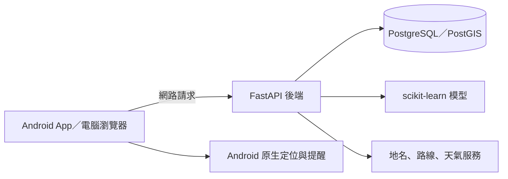

# 專題-有路安APP

目前 App 保留地圖、排行、設定三個分頁。回報與動態牆已取消；「路口體檢報告」仍可查看官方歷史事故分析。首次安裝不預設任何私人伺服器位址，請向管理者取得完整連線位址，再到設定測試並儲存。

**有路安**是資料庫課程的 Android 專題。我們把警政署的歷史事故資料整理成危險路口，讓使用者在出門前查看路線，行經路口時收到提醒。

> 依官方歷史事故統計提醒注意，不保證路況安全。歷史事故多不代表現在一定危險，事故少也不代表安全。

這份 README 寫給第一次接觸專案的組員。先理解程式怎麼運作，再選擇只看程式、在電腦試用，或打包到 Android 手機。

- 想先讀懂：[程式閱讀指南](docs/code-guide.md)
- 想讓自己的 AI agent 帶著學：[組員入門與 agent 教學](docs/team-agent-guide.md)
- 想看資料庫：[ER 圖](docs/er-diagram.md)／[筆數報告](docs/db-report.md)
- 想看 AI 做了什麼：[肇因模型](docs/ai-report.md)／[雨天校正](docs/ai-report-rain.md)

## 1. 這個程式能做什麼

| 功能 | 使用情境 | 怎麼實現 |
|---|---|---|
| 危險路口地圖與排行 | 出門前查附近或沿路的事故熱點 | API 查 PostgreSQL 的路口與事故資料，前端在地圖標示 |
| 天候與時段篩選 | 比較雨天、夜間與一般情況 | SQL 篩選歷史事故發生時的天候與時間 |
| 路口體檢報告 | 了解常見肇因、時段、車種與改善建議 | 資料庫分組統計，搭配規則式建議，可匯出 HTML 報告 |
| AI 肇因情境預測 | 選擇天候、時段等條件，查看可能的肇因 | scikit-learn 分類模型；每次預測記錄模型版本 |
| 模擬行走 | 沒有 GPS 或在教室也能展示提醒 | 藍點沿路線前進，進入路口提醒範圍時顯示提示與語音 |
| Android 背景守護 | 切到導航或鎖屏後繼續提醒 | Android 前景服務取得位置，判斷距離，發出通知、語音及浮動提醒 |
| 家人模式 | 替家人規劃常走路線 | 路線存進資料庫，另一台手機輸入六碼代碼下載 |
| 後台統計 | 展示專題確實使用資料庫 | 即時 SQL 筆數、資料表關係及各月事故數 |

即時天氣另外由後端查中央氣象署。沒有設定自己的氣象署授權碼時，仍可手動切換天候；即時自動模式不可用。AI 不是 ChatGPT API，也不需要組員提供 OpenAI 或 Anthropic API key 才能使用本專題的肇因模型。

## 2. 整個系統如何連起來



- **前端**：JavaScript、Vite、Leaflet、MapLibre，負責畫面、地圖與操作。
- **Android**：Capacitor 把前端包成 APK；Java 服務處理背景定位與提醒。
- **後端**：Python FastAPI，接收請求、查資料庫、使用模型並回傳結果。
- **資料庫**：PostgreSQL，支援 PostGIS 空間查詢，也有一般 SQL 的替代查詢。
- **AI**：scikit-learn 模型在自己的電腦訓練，模型檔與資料庫分開保存。

手機只連 API，不直接連資料庫。管理者可提供 HTTPS 外出連線位址，手機使用行動網路也能連線；區網位址則需要同一個 Wi-Fi。GitHub 用來分享程式，**公開倉庫不等於已部署可用的伺服器**。

## 3. 資料來源與 AI

事故資料來自[警政署即時交通事故資料 A2 類](https://data.gov.tw/dataset/13139)。目前既有報告使用民國115年1–10月，記錄事故 **284,116件**、當事人 **640,620列**、危險路口 **18,573處**。這是既有匯入結果；重新下載時若官方資料更新，筆數可能不同，請以自己的 SQL 查詢為準。

一件事故可能有多位當事人，因此當事人列數不等於事故件數。匯入後分成 accident、party 等資料表，再做座標品質檢查及路口彙整。

AI 有兩部分：

1. **肇因分類**：用歷史資料訓練，依時間分開訓練、驗證與測試，並和「一直猜最常見肇因」比較。它提供情境提醒，不是預測接下來一定發生的事故。
2. **雨天校正**：結合測站實際雨量，檢查「雨天事故多」是否只是當地下雨日多。沒有顯著差異就保留證據不足的結果，不把每個路口都標成雨天高風險。

資料表與測試數字詳見上方文件。GitHub 不包含整份事故原始檔、執行中的資料庫或訓練模型檔；首次在自己的電腦使用時需要重新下載、建立與訓練。

## 4. 組員如何取得專案

GitHub：<https://github.com/DHKGOD/YouLuAn-APP>

有 Git 的話，在自己選的資料夾執行：

```powershell
git clone https://github.com/DHKGOD/YouLuAn-APP.git youluan
cd youluan
```

也可在 GitHub 選 **Code → Download ZIP** 再解壓縮。若要交修改，建議使用 Git；先 Fork 到自己的帳號，再開自己的分支。公開觀看不需要成為協作者，直接寫入共同倉庫則需要管理者另外授權。

## 5. 先在 Windows 電腦試用

### 準備工具

| 工具 | 何時需要 |
|---|---|
| [Git](https://git-scm.com/downloads) | 下載程式與管理修改；只下載 ZIP 可先不用 |
| [uv](https://docs.astral.sh/uv/getting-started/installation/)＋Python 3.11 | 後端、資料匯入與 AI；uv 可管理 Python |
| [Node.js](https://nodejs.org/en/download) | 建置前端；原開發環境使用 Node.js 24 |
| PostgreSQL | 儲存資料；PostGIS 可加速空間查詢 |
| JDK 21、Android SDK | 只有要打包 APK 才需要 |

這裡主要說明 Windows。macOS／Linux 的 PostgreSQL 安裝方式不同，請參考[雲端部署](docs/deploy-cloud.md)，不要直接執行 Windows 安裝腳本。

### 第一次啟動

在剛下載的專案根目錄執行：

```powershell
uv python install 3.11
uv sync --python 3.11
```

尚未安裝 PostgreSQL 的 Windows 使用者，可先查看專案的安裝腳本，再執行：

```powershell
powershell -NoProfile -ExecutionPolicy Bypass -File scripts\install_postgres.ps1
```

這支腳本從 EnterpriseDB、OSGeo 下載 PostgreSQL 18 與 PostGIS，放在自己的使用者工具目錄，不建立 Windows 服務。若電腦已有 PostgreSQL，先讓 agent 確認版本、連接埠與 PG_BIN，避免和原本的資料庫混在一起。

接著雙擊 **start_server.bat**。首次啟動會建立自己的 .env 與隨機密碼、初始化資料庫、下載事故資料、整理路口、訓練模型及建置畫面。首次所需時間受網路與電腦效能影響，請等進度訊息，不要反覆開很多視窗。

看到啟動成功後：

- 電腦瀏覽器開 <http://127.0.0.1:8000/>。
- API 文件開 <http://127.0.0.1:8000/docs>。
- 確認 <http://127.0.0.1:8000/api/health> 的 status 是 ok。
- 關掉啟動視窗可停止；背景啟動的服務可用 stop_server.bat 停止。

若模型訓練失敗，伺服器仍可能開啟，但 AI 功能暫時不可用；請查看訊息，不要把「能看到首頁」當成全部完成。

### 可選的即時天氣

需要的人自行取得氣象署授權碼，在**自己的 .env** 加上：

```dotenv
CWA_API_KEY=請填自己的授權碼
```

這是示意文字，不是可用金鑰。不需要把授權碼貼給組員或上傳 GitHub。歷史雨量校正另可執行 uv run python ai/rain_risk.py；它需要自己的授權碼或已下載的雨量快取。

## 6. 放到 Android 手機

要直接安裝：到 [GitHub Releases](https://github.com/DHKGOD/YouLuAn-APP/releases) 下載最新 APK（Android 7 以上），安裝後向管理者取得完整位址，貼入 App 首次設定或「設定 → 伺服器位址」，再按「測試並儲存」。公開 APK 沒有預設位址、通行碼或 API key。

使用管理者提供的 HTTPS 外出位址時，不必連相同 Wi-Fi；管理者電腦、後端及連線通道仍須保持運行。通道網址若更換，請重新向管理者取得，不要在公開 issue 張貼私人連線位址。

要在自己的電腦部署並打包，先確認電腦網頁正常。區網測試時，手機與電腦連同 Wi-Fi，填自己的區網位址。

有 JDK 21、Android SDK 後，可先只打包：

```powershell
powershell -ExecutionPolicy Bypass -File scripts\build_apk.ps1 -NoInstall
```

APK 會在 dist/traffic-safety-debug.apk。要由腳本透過 USB 安裝，可拿掉 -NoInstall；手機須開啟 USB 偵錯並信任自己的電腦。背景守護還需要手機授予定位、通知等權限，浮動小球需要「顯示在其他應用程式上層」。

瀏覽器版可以看地圖與操作資料，但沒有 Android 背景服務。電腦關機、睡眠或通道停止時，手機會連不到後端。不要直接把 PostgreSQL 連接埠開放給外網。

## 7. 讓自己的 ChatGPT／Codex 或 Claude 帶著學

**不是把 App 安裝進 ChatGPT／Claude。** 是把這份程式放在自己的電腦，讓具備本機資料夾存取能力的 agent 讀檔、解釋與協助執行。

- 只想理解：把 README、閱讀指南或相關程式提供給聊天工具，請它逐步說明。
- 想實際啟動與測試：使用本機 Codex 或 Claude Code，選取自己的 youluan 資料夾。
- 想用雲端 agent：可以協助讀 GitHub 程式，但不能直接把雲端環境當成自己的手機、USB 裝置或區網 PostgreSQL。

先貼這段：

```text
我是這個資料庫專題的組員，第一次讀這份程式。
請先讀 README.md、docs/code-guide.md、docs/team-agent-guide.md、
AGENTS.md 和 HANDOFF.md，再看目前檔案與 git status。

先不要修改或啟動服務。請用繁體中文說明：
1. 使用者按下查附近路口後，前端、API、SQL 如何合作。
2. 事故、當事人、危險路口為什麼要分表。
3. AI 用什麼資料、輸出什麼，和一般統計差在哪裡。
每次只教一個流程，附實際檔名，確認我理解後再繼續。
```

準備啟動、排錯及分工時，直接用[組員 agent 教學](docs/team-agent-guide.md)裡的提示詞。每個人用自己的帳號與本機設定；不需要共用組長的 API key、登入或資料庫密碼。agent 的帳號權限與使用額度由各服務決定。

官方操作說明：[OpenAI 本機專案入門](https://learn.chatgpt.com/docs/quickstart)／[Claude Code 入門](https://code.claude.com/docs/en/quickstart)。

## 8. 改程式與驗證

| 工作 | 指令／入口 |
|---|---|
| 後端測試 | uv run pytest |
| 前端開發 | 在 frontend 執行 npm ci，再執行 npm run dev |
| 前端正式建置 | 在 frontend 執行 npm run build |
| 完整操作測試 | powershell -ExecutionPolicy Bypass -File scripts\e2e.ps1 |
| Java 提醒邏輯測試 | powershell -ExecutionPolicy Bypass -File scripts\test_guardian.ps1 |
| 重新訓練肇因模型 | uv run python ai/train_cause_model.py |

2026-10-24 原開發環境的整理版本：後端52項、完整操作27項、Java8項通過，Android Java編譯通過。這些是既有測試紀錄，不代表已在每位組員的電腦與手機驗證。

2026-10-28 更新：公開來源的後端74項通過（使用既有測試資料庫，未重新匯入）；Android 首次設定單元測試2項通過。手機與平板瀏覽器共27個情境已通過，失敗的新增測試操作已修正並重跑；最後刪除裝置代碼及顯示正確版本後，再重跑首次設定、回報入口與伺服器設定3項皆通過。APK 已建置並通過簽章及私人設定檢查。這次未在手機重新安裝新版，因此定位／鎖屏行為仍須實機驗收；首次完整資料下載及匯入仍需在組員環境驗證。

每位組員開自己的分支，例如 member/map-notes。先看 git status，避免覆蓋別人的修改；交回程式時說明改了什麼及怎麼測試。沒有共同倉庫寫入權限時，用 Fork＋Pull Request 交回。

## 9. 公開版包含與不包含什麼

包含 App 與後端程式、資料匯入／模型訓練工具、資料表 migration、測試與組員教學。Releases 另提供 Android 測試 APK、SHA256 校驗值及驗證摘要。

不包含私人設定、API key、伺服器通行碼、原作者的資料庫與模型、手機資訊或本機 agent 設定。舊回報表僅為相容歷史 migration 而保留，不提供新增或讀取 API。


原始事故資料與地圖等外部服務的授權、使用限制仍依各自來源。這份課程專題沒有另外授予第三方程式或資料的權利；不要把公開可讀誤解為所有內容都能任意商用。

更完整的檔案位置見[程式閱讀指南](docs/code-guide.md)，伺服器搬遷見[部署文件](docs/deploy-cloud.md)，設計理由見[技術決策](docs/decisions.md)。
